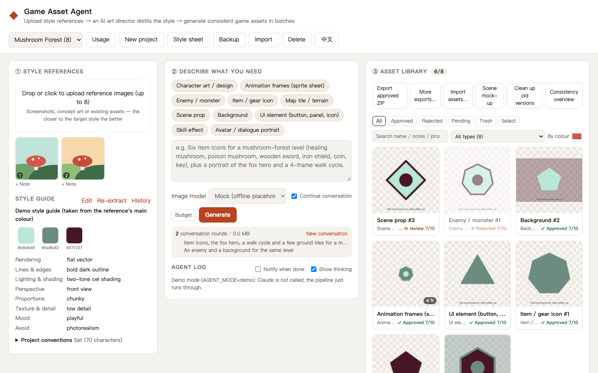
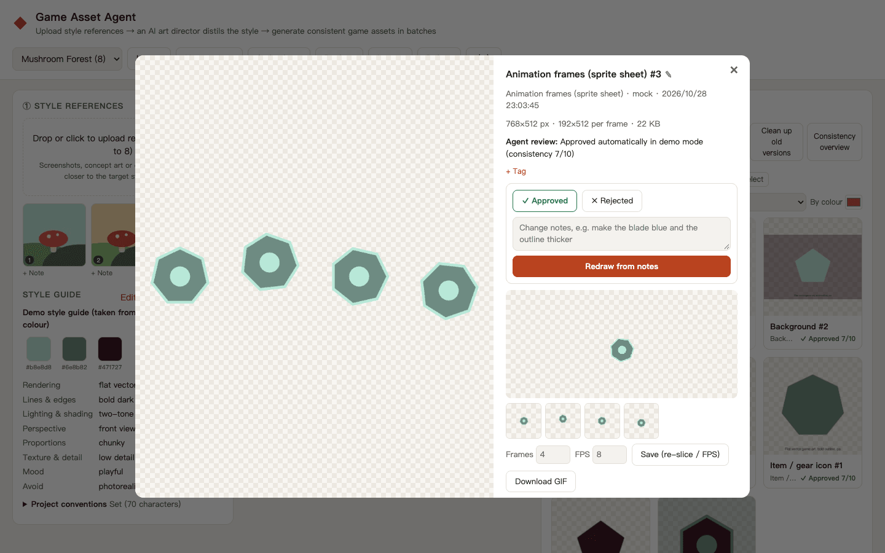

# Game Asset Agent

English · [中文](README.md)

[](https://github.com/wangchaozhi/game-asset-style-agent/actions/workflows/ci.yml)

Upload a few style reference images and let Claude, DeepSeek Flash or GPT act as your **AI art director**. It distils a reusable **style guide** from the references (palette hex codes, technique, line work, lighting, camera, proportions), plans an asset list from your request, generates the images with an image model, **looks at every result and reviews it**, and redraws whatever drifts — so you end up with a set of assets that look like they come from the same game.

<picture>
  <source media="(prefers-color-scheme: dark)" srcset="docs/screenshots/en/main-dark.png" />
  
</picture>

<sub>Screenshots are from demo mode (`AGENT_MODE=demo`) with offline placeholder art; with an agent and an image model connected you get real generations. The UI is in Chinese.</sub>

## Features

- 🎨 **Style extraction** — The agent analyses the references and saves a structured style guide that every later generation in the project reuses
- 🧩 **10 asset types** — characters, sprite sheets, enemies, item icons, tiles, props, backgrounds, UI, VFX, portraits
- 🔁 **Self-review loop** — each image is scored 1–10 for consistency against the references, with automatic palette, tile-seam and frame-jitter checks attached. Seams, jitter and leftover backgrounds are fixed with free post-processing tools; anything else is redrawn with specific feedback (at most twice per asset)
- 🎯 **Palette check** — ΔE distance in Lab space between an asset and the style palette: share of on-palette pixels and the main off-palette colours
- 🧬 **Cross-asset consistency** — approved assets (e.g. the hero's design sheet) can be passed as extra references for the same character's animation frames or portrait
- 🏃 **Action sets** — pick a character or enemy and get idle / walk / attack / hurt … sprite sheets in one go, each using it as the consistency reference with a fitting frame rate
- 🖼️ **Scene layout preview** — drop approved assets onto a background (scene art, tiled tiles or a flat colour), drag, scale and flip them to check the set works together, and download a PNG
- 📘 **Style sheet** — a one-page HTML (palette, rules, references with notes, approved samples) to hand to outsourced artists or print
- 📏 **Project conventions** — write your team's own art rules (e.g. "2px outline on every icon"); they go to Claude on every run and into the style sheet
- 🎨 **Built-in style presets** — start a project as pixel art, flat cartoon or watercolour and generate right away without reference images; edit it or upload references later
- 🌐 **English and Chinese interface** — switch in the header (remembered; the first visit follows your browser language); server-written text such as asset notes, drift reasons, the run log and error messages follows along
- 🛠️ **Asset workbench** — sprite slicing and frame alignment, frame stepping with onion skin, one-click seamless tiles, UI 9-slice margins with stretch preview, background removal, game-size exports, 1×–16× zoom with a pixel grid, version compare (slider / side by side), similar assets, editing a prompt and regenerating directly (no agent)
- 🗂️ **Library management** — search syntax (`#tag`, `type:`, `status:`, `-exclude`, tag completion), batch approve / reject / redraw with feedback / outline / cut out / palette snap / rename / export with one-click undo, duplicate groups with cleanup, a right-click / long-press menu and full keyboard use, trash (restorable for 7 days), style-guide history with rollback, notes on reference images, project backup and restore
- 📦 **Engine-ready exports** — ZIP per asset type (with common sizes, a manifest and Godot 4 `.tres` — `SpriteFrames` for sprite sheets, 9-slice `StyleBoxTexture` for UI, a `TileSet` for tiles, one multi-animation `SpriteFrames` per character — and optional Unity `.meta` files plus sprite-sheet AnimationClips, with sprite-sheet slicing, 9-slice borders and pixel-art filtering), plus texture atlases (PNG + TexturePacker JSON, loads directly in Phaser / PixiJS) with Phaser animation definitions and optional Cocos Creator `.plist` atlases; built-in Unity / Godot / Phaser / Cocos export presets, and a list of what will be skipped before you download
- 💰 **Cost control** — live token / image usage and cost estimates, per-run caps on image calls and USD, automatic backoff on image-API rate limits
- 🔌 **Pluggable image models** — OpenAI GPT Image 2.5 Flare / Sunburst (API), Google Gemini Image, Volcengine Doubao Seedream 5.0 Flash, local Stable Diffusion WebUI, built-in Codex subscription image generation, ChatGPT human handoff, offline mock



## Quick start

```bash
npm install
cp .env.example .env   # configure Claude, DeepSeek or GPT and an image provider (see below)
npm start              # http://localhost:5173
```

Try the UI without any keys:

```bash
AGENT_MODE=demo npm start
```

Demo mode doesn't call an agent model; a script runs the pipeline (style guide → generation → library) with local placeholder images.

To use DeepSeek without an Anthropic key, set the following in `.env` and remove `AGENT_MODE=demo`:

```dotenv
AGENT_PROVIDER=deepseek
DEEPSEEK_API_KEY=your-deepseek-key
DEEPSEEK_MODEL=deepseek-flash
```

DeepSeek Flash analyses references, plans assets and visually reviews results. Configure Seedream, OpenAI, Gemini or local Stable Diffusion separately to generate real images; Mock can exercise the workflow. The default Anthropic-compatible endpoint is `https://api.deepseek.com/anthropic` (`DEEPSEEK_BASE_URL` overrides it). `DEEPSEEK_EFFORT` accepts `low`, `high` or `max` (default `high`). See the [official vision guide](https://api-docs.deepseek.com/guides/vision/); `deepseek-v4-pro` does not support vision. Switching agent services or models starts a fresh conversation while preserving the style guide and assets. Existing Claude configuration remains the default (`AGENT_PROVIDER=claude`).

DeepSeek Flash token costs are estimated conservatively at peak rates. Override them with `DEEPSEEK_PRICE=input,output,cacheWrite,cacheRead` in USD per million tokens. The API retains the legacy `claude` usage/cost fields for both services; actual model names appear in `claude.byModel`.

### GPT with an API key or ChatGPT plan

Configure either billing mode in `.env`:

```dotenv
AGENT_PROVIDER=gpt
GPT_AUTH_MODE=api_key
GPT_MODEL=gpt-6.1-sol
OPENAI_API_KEY=your-platform-api-key
```

API key usage is billed separately through OpenAI Platform; ChatGPT Plus does not cover these requests. Create a key in [OpenAI Platform](https://platform.openai.com/api-keys). `GPT_BASE_URL` overrides the API endpoint (default `https://api.openai.com/v1`); `GPT_EFFORT=low|medium|high|xhigh|max` defaults to `medium` and must be supported by your selected model.

To use a ChatGPT subscription instead, set `GPT_AUTH_MODE=chatgpt`, remove `AGENT_MODE=demo`, restart, open `http://127.0.0.1:5173` and click **Continue with ChatGPT** in the request panel. Authorize ChatGPT plan usage in the new browser window. You can add/select separate account or workspace registrations, reauthorize them, sign out, or list models available to the active account. Put the selected model id in `GPT_MODEL` and restart. The app implements the [official OSS OAuth flow](https://developers.openai.com/siwc/token-sharing-open-source), validates identity tokens and granted scopes, and renews access tokens. It uses its own credentials; it does not read Codex login files. Availability depends on your account, workspace and remaining plan allowance. There is no automatic fallback to paid API-key requests. Subscription mode always uses the official Responses endpoint and ignores `GPT_BASE_URL`.

For terminal login, run `npm run chatgpt:login` and open the printed URL on the same machine; use `-- --new` to register another account or `-- --account oaiapp_…` to reauthorize a saved registration. Credentials are stored under `DATA_DIR/auth/chatgpt.json`, outside project backups, with owner-only file permissions on Unix. Restrict data-directory access on Windows. Browser login management accepts direct loopback requests only. For Docker or remote self-hosting, complete login locally and securely transfer the protected credential file to the instance's `DATA_DIR/auth/` following the [official self-hosted guide](https://developers.openai.com/siwc/token-sharing-open-source/self-hosted-vms). Only run one instance against a data directory to avoid rotating-token conflicts. Signing out attempts remote revocation and clears local tokens; if revocation cannot be confirmed, disconnect the app in ChatGPT Settings.

Both modes support reference analysis, tools and visual reviews. Image generation still uses the separately configured image provider; subscription credentials never serve as image-provider keys. See the [subscription route limitations](https://developers.openai.com/siwc/token-sharing-open-source/preview-limitations). GPT API prices are estimated at the default model's Standard short-context rates; override with `GPT_PRICE=input,output,cacheWrite,cacheRead` in USD per million tokens. Subscription requests retain token counts with `cost.claude=0` to indicate no Platform API token charges; image charges remain separate. Runs record `agent.authMode`; the legacy `claude` fields cover all agent providers. Changing providers, models, billing modes or ChatGPT accounts resets conversation history while preserving the style guide and assets.

If your browser can open OpenAI's sign-in page but the app reports a discovery HTTP 403, check the Node backend's network path. Windows/v2rayN system-proxy settings are not inherited by Node. Configure the actual HTTP/Mixed proxy address in `.env`, for example `HTTP_PROXY=http://127.0.0.1:10808` and `HTTPS_PROXY=http://127.0.0.1:10808`, with `NO_PROXY=localhost,127.0.0.1,::1`, then restart the server. Both target protocols use the proxy client's HTTP URL, not a SOCKS URL. Server startup and `chatgpt:login` apply `http.setGlobalProxyFromEnv` after dotenv, including OAuth discovery/JWKS/token requests and GPT SDK calls; use a Node release exposing that API (verified with Node 24.15.0). All Node outbound HTTP/HTTPS requests use the proxy, while local UI and OAuth callbacks always bypass it. TLS and identity verification remain enabled.

cc-switch/Codex authentication is separate from this app's OAuth client. `codex_image` already uses the CLI's sign-in; the agent's `GPT_AUTH_MODE=chatgpt` still requires this app's own authorization. Reusing CLI sign-in for the agent would require a Codex app-server/CLI integration, rather than copying rotating refresh tokens into the app's credential file.

### Codex subscription images and human handoff

Select a default with `IMAGE_PROVIDER`; the UI and per-run HTTP `provider` can still select another enabled channel. For built-in Codex images:

```dotenv
IMAGE_PROVIDER=codex_image
CODEX_IMAGE_AUTH_MODE=chatgpt
CODEX_IMAGE_VARIANT=auto
CODEX_IMAGE_TIMEOUT_MS=300000
CODEX_IMAGE_CONCURRENCY=1
CODEX_IMAGE_FALLBACK=none
```

Install Codex CLI and run `codex login` as the same OS user that runs the server, using ChatGPT sign-in. `CODEX_IMAGE_BIN` defaults to `codex` and can point to `codex.exe` or the official `codex.js` launcher on Windows; `CODEX_IMAGE_HOME` can select its credential directory. CLI authentication is separate from the app's Continue with ChatGPT OAuth connection. The provider runs `codex exec` in an isolated directory, invokes `$imagegen`, passes references, and accepts only an actual validated `asset.png` output. It strips the app's API keys/tokens from the child environment, uses the workspace-write sandbox without elevating permissions, enforces timeout/concurrency, and terminates workers on cancellation. Verify one image against your local CLI/account before relying on the workflow.

The installed built-in imagegen tool has no public image-model parameter. `CODEX_IMAGE_VARIANT` therefore accepts only `auto`; `flare`/`sunburst` fail explicitly. `CODEX_IMAGE_AGENT_MODEL` selects the language model running the task, not the image model. Exact image-model selection is available in the separately billed API provider with `OPENAI_IMAGE_MODEL=gpt-image-2.5-flare` or `gpt-image-2.5-sunburst`; the API default is now Flare, replacing retired `gpt-image-1`. See [Codex image generation](https://learn.chatgpt.com/docs/image-generation) and [API image tools](https://developers.openai.com/api/docs/guides/tools-image-generation).

`CODEX_IMAGE_FALLBACK=none` stops on failure. Only an explicit `seedream` value uses Ark credits; `chatgpt_manual` switches to human handoff. Assets and usage record the provider that actually produced the image. Set `CODEX_IMAGE_ENABLED=true` to enable the picker option without making it the default.

For human handoff, set `IMAGE_PROVIDER=chatgpt_manual` (or enable the picker with `MANUAL_IMAGE_ENABLED=true`). When the agent requests an image, a card appears with a ZIP containing `prompt.txt`, references, manifest and instructions. Generate the image in ChatGPT, download the full original and upload PNG/JPEG/WebP (max 20 MB) to that card. The original tool call resumes and the agent reviews the uploaded image. Refreshed pages reload the task list. `MANUAL_IMAGE_TIMEOUT_MS` defaults to 86400000 (24 hours; valid range 100–604800000). Cancelling a card stops its original job. Prompt/reference files remain in the project's `handoffs/` directory, outside existing project backup ZIPs.

After a restart, timeout or stopped job, upload the result and click Continue review to import it and start a new visual-review job. The same handoff is not imported twice. If agent credentials fail, the imported asset remains pending for manual review; demo continuations import only. Codex subscription and human outputs count against the image-call budget but add no Platform image API estimate; actual subscription usage/credits follow Codex or ChatGPT.

### Generate images with Seedream 5.0 Flash

No OpenAI or Gemini image key is required:

```dotenv
ARK_API_KEY=your-volcengine-ark-key
SEEDREAM_MODEL=doubao-seedream-5-0-flash-260915
SEEDREAM_BASE_URL=https://ark.cn-beijing.volces.com/api/v3
SEEDREAM_SIZE=2K
SEEDREAM_WATERMARK=false
SEEDREAM_RESPONSE_FORMAT=b64_json
```

Keep your agent configuration, remove `AGENT_MODE=demo`, restart and select **Doubao Seedream 5.0 Flash** in the image-provider picker. HTTP run and manual-regeneration requests accept `"provider": "seedream"`. When it is the first available image provider, Seedream is selected automatically. A GPT Platform API key also enables the OpenAI image provider, so explicitly select Seedream in that case.

The provider sends JSON requests with inline Base64 references to `/images/generations`. It defaults to a single Base64 PNG output; `SEEDREAM_RESPONSE_FORMAT=url` downloads the temporary URL immediately without forwarding the Ark key. Image-download retries do not re-submit the generation. Group generation and layer decomposition are not enabled. See the [official Flash/Pro guide](https://docs.volcengine.com/docs/ark/seedream-5-0-pro?lang=zh) and [API reference](https://docs.volcengine.com/docs/ark/image-generation-api?lang=zh).

`SEEDREAM_SIZE` accepts `1K`, `1.5K` or `2K` (default). Square outputs are 1024×1024, 1536×1536 or 2048×2048 respectively; landscape outputs are 1280×720, 1920×1080 or 2560×1440, and portrait outputs swap width and height. Sprite strips use one square cell per frame (2–16 frames) within the model's pixel/ratio limits. Up to 10 references are sent: existing consistency assets first, then project style references. Omitted references are reported in the job log.

Native transparency requires a single alpha reference, while project references are flattened JPEGs. Cutout assets therefore use a flat white backdrop and the existing local background-removal step; originals remain available. Visible watermarks are disabled by default and can be enabled with `SEEDREAM_WATERMARK=true`. Set `IMAGE_PRICE_SEEDREAM` in USD per generated image for cost estimates; leave it blank to track calls with unknown cost, excluded from the dollar budget. Convert RMB prices before entering them. Actual resolution/reference-related charges follow the Ark bill. Keep `ARK_API_KEY` in the server environment, never in frontend code or chat.

### Generate images through a relay (OpenAI / Gemini compatible)

To use image models behind a relay instead of the official endpoints, no code change is needed: both the OpenAI images protocol and the Gemini native protocol accept a custom base URL and their own key.

**OpenAI images protocol** (`/v1/images/generations` and `/v1/images/edits`, references supported):

```dotenv
IMAGE_PROVIDER=openai
OPENAI_IMAGE_API_KEY=sk-relay-key
OPENAI_IMAGE_BASE_URL=https://api.pinaic.com/v1
OPENAI_IMAGE_MODEL=gpt-image-2.5-flare
```

`OPENAI_IMAGE_API_KEY` / `OPENAI_IMAGE_BASE_URL` apply to the image channel only; when empty they fall back to `OPENAI_API_KEY` / `OPENAI_BASE_URL`, so the official key used by the GPT agent can stay separate. Requests keep the official shape (`background`, `size`, multipart references), and the relay must accept those fields. The model name must appear in the relay's `/v1/models`.

**Gemini native protocol** (`/v1beta/models/<model>:generateContent`, references sent as `inline_data`):

```dotenv
IMAGE_PROVIDER=gemini
GEMINI_API_KEY=sk-relay-key
GEMINI_BASE_URL=https://api.pinaic.com
GEMINI_IMAGE_MODEL=gemini-3.1-flash-image
```

`GEMINI_BASE_URL` is the host only — do not append `/v1beta`; leave it empty for the official `https://generativelanguage.googleapis.com`. Aspect ratios map to `1:1`, `3:2` and `2:3`; returned JPEG/PNG data is stored by the existing pipeline.

Notes:

- With both channels configured, set `IMAGE_PROVIDER` explicitly; otherwise the first available provider in the built-in order is selected.
- Relays are usually slower (roughly 1–3 minutes per image). 429 / 5xx responses still use `IMAGE_MAX_RETRIES` with exponential backoff, and the job's stop button still aborts the request.
- Cost estimates still use `IMAGE_PRICE_OPENAI` (USD per image); leave it blank to track calls without a dollar estimate. The relay's own bill remains authoritative.
- To check which image models a key/group can use first, run the standalone `node tools/test-image-api.mjs --key sk-xxx` (see `--help`).

## Deployment

### Docker

```bash
cp .env.example .env          # fill in your keys
docker compose up -d --build  # http://localhost:5173
```

Data lives in the `asset-data` volume (`/data` in the container). Change the port with `PORT=8080 docker compose up -d`. Without compose:

```bash
docker build -t game-asset-agent .
docker run -d -p 5173:5173 --env-file .env -v gaa-data:/data game-asset-agent
```

The image is a multi-stage build: TypeScript is compiled to `dist/`, the runtime layer has production dependencies only, runs as the non-root `node` user, and has a `/healthz` health check.

### Plain Node (≥ 22)

```bash
npm ci && npm run build
NODE_ENV=production npm run start:prod
```

### Before going public

- **Set `ACCESS_TOKEN`.** The UI then asks for the token once (an HttpOnly session cookie, 30 days); scripts send `Authorization: Bearer <token>`. `/healthz` stays open. Without it, anyone who can reach the port can spend your API credit.
- Jobs are tracked in memory: run **one instance** per data directory. A restart interrupts running jobs (assets already generated are kept; the run is marked interrupted).
- Server-sent events need proxy buffering off (Nginx: `proxy_buffering off;`).
- Failed logins are rate-limited per IP (10 per 10 minutes by default). Behind a reverse proxy set `TRUST_PROXY=1` (or `loopback`) so the real client IP is used.
- Responses carry a CSP, `nosniff`, no-framing and related security headers.

## Configuration

See [.env.example](.env.example). Data is stored under `data/` (git-ignored).

## HTTP API

Everything the UI does is available over HTTP (batch generation, exports, review…): see [docs/api.md](docs/api.md) (in Chinese), including a script that goes from creating a project to downloading an atlas.

## Development

```bash
npm run typecheck   # tsc (strict + unused checks, includes test/)
npm run lint        # ESLint for the browser modules in public/js
npm test            # node:test + tsx: storage, tool validation, image providers, image processing,
                    # atlases, ZIP, pricing, auth, the agent loop against a fake Messages API, HTTP API
npm run coverage    # tests + coverage (≥ 90% lines, 80% branches, 85% functions — enforced in CI)
npm run check       # all of the above
```

Tests use a temporary `DATA_DIR`; API tests start the app in demo mode on a random port, and the agent loop is exercised against a local fake of the Messages API that streams real SSE events — no API keys needed.

## How it works

The agent is a hand-written tool-use loop on the Anthropic TypeScript SDK (`src/agent/loop.ts`), using `claude-opus-5-5` with adaptive thinking, prompt caching and server-side refusal fallback. DeepSeek uses the same loop through its Anthropic-compatible endpoint, with service-specific request parameters. Its tools:

| Tool | Purpose |
|---|---|
| `save_style_guide` | Save the style guide distilled from the references (incl. an English `prompt_prefix`) |
| `generate_image` | Call the image model with the references (and optional approved assets) attached; the result image and automatic checks go back to the agent |
| `review_asset` | Record approve / reject, a consistency score and the reason |
| `fix_tile_seams` | Cross-fade a tile's edges into a seamless new version (no image-model call) |
| `align_sprite_frames` | Align a sprite sheet's frames on a shared anchor (no image-model call) |
| `remove_background` | Re-cut the background with another tolerance (no image-model call) |
| `snap_to_palette` | Recolour a flat / pixel-art asset to the style palette when stray colours appear (no image-model call) |
| `set_nine_slice` | Detect (or take) 9-slice margins for stretchable UI — panels, buttons, bars — save them and return a stretched preview to check (no image-model call) |
| `add_outline` | Add a uniform outer outline when the style calls for one and an asset lacks it (colour defaults to the darkest palette colour; no image-model call) |
| `recolor_variant` | Colour-swap variants — elite / element enemies, outfit colours, rarity tiers — as new assets with shading kept (no image-model call) |
| `check_consistency` | Self-check before finishing: measure every asset against the palette and list the ones drifting most, with reasons, so the agent can fix or redraw them (no image-model call) |

See the architecture section of the [Chinese README](README.md#架构) for the source layout.

## Changelog

See [CHANGELOG.md](CHANGELOG.md) (in Chinese) for what changed in each version.

## License

MIT
